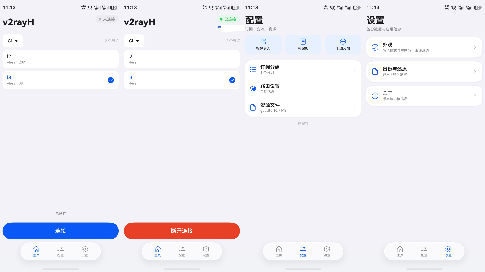

# v2rayH

A HarmonyOS / OpenHarmony port of [v2rayNG](https://github.com/2dust/v2rayNG): a
VLESS / VMess / Trojan / Shadowsocks client that drives a real VPN through the
in-tree [Xray-core](https://github.com/xtls/xray-core) kernel.

Traffic flow:

```
apps ──► vpn-tun (VpnExtensionAbility) ──► gVisor netstack (L3→L4)
     ──► Xray VLESS+REALITY outbound ──► internet
```

## Layout

| Path | What |
| --- | --- |
| `entry/src/main/ets/` | ArkTS UI, subscription parsing, VPN extension ability |
| `entry/src/main/cpp/` | NAPI module (`libentry.so`) that hosts the Go kernel |
| `native/libxray/` | Go wrapper + vendored, patched `xray-core` and `gvisor` |
| `native/build_libxray.sh` | rebuild `libxray.a` (openharmony/arm64) — Linux/CI |
| `native/build_libxray.ps1` | same, for a Windows host |
| `.github/workflows/build-libxray.yml` | CI that produces `libxray.a` |

## Native kernel

The kernel is built as a **c-archive** which CMake statically links into
`libentry.so`, so there is no runtime SONAME to ship.

Two things are needed to build it:

1. **ohos-go** — a Go toolchain that knows `GOOS=openharmony`/`GOARCH=arm64`.
   Prebuilt `linux-amd64` / `darwin-arm64` tarballs come from
   <https://github.com/sysit/ohos-go/releases>.
   (Stock Go cannot target OpenHarmony. The stock compiler also emits
   `R_AARCH64_TLS_TPREL64` initial-exec TLS relocations, which musl refuses at
   `dlopen`; ohos-go emits `R_AARCH64_TLSDESC` instead.)
2. **OpenHarmony SDK native toolchain** — `clang` + `sysroot` for
   `aarch64-linux-ohos`. Comes from either DevEco Studio
   (`sdk/default/openharmony/native/…`) or the public mirror
   <https://repo.huaweicloud.com/openharmony/os/>, where
   `ohos-sdk-windows_linux-public.tar.gz` contains a per-component
   `linux/native-*.zip`.

```bash
# Linux / CI
OHOS_GO=/path/to/ohos-go OHOS_SDK=/path/to/ohos-sdk ./native/build_libxray.sh

# Windows
.\native\build_libxray.ps1 -OHOS_GO C:\ohos-go -OHOS_SDK "C:\Program Files\Huawei\DevEco Studio\sdk\default\openharmony"
```

Both copy the result into `entry/src/main/cpp/thirdparty/libxray/`
(`libs/arm64-v8a/libxray.a` + `include/libxray.h`), which is git-ignored —
`devecocli build` needs it present.

## Building the app

```bash
devecocli build
devecocli run --skip-build
```

`build-profile.json5` sets `compatibleSdkVersion` to `6.0.0(20)`, so the HAP
installs on HarmonyOS 6.0 and later. The project compiles against the installed
API 26 SDK; code that uses an API newer than 6.0 is guarded at runtime (see
`@compatibility/api-compatibility-check` in `code-linter.json5`).

## CI

Two workflows:

- `.github/workflows/build-libxray.yml` — builds the Xray kernel
  (`libxray.a`) and attaches it to releases.
- `.github/workflows/build-hap.yml` — builds the **unsigned HAP** with
  `devecocli` on `ubuntu-22.04` and publishes it when a release is published
  (or on manual dispatch).

### How the HAP is built without DevEco Studio

Huawei's **Command Line Tools** (CLT) for Linux embed the HarmonyOS SDK, and
`devecocli` officially supports Linux when `DEVECO_CLI_CLT_PATH` points at the
extracted CLT. That replaces the old "OpenHarmony SDK + hvigor license
workaround" attempt.

One-time bootstrap (the CLT archive is behind Huawei's download portal):

1. Download `commandline-tools-linux-x64-26.0.0.zip` from
   <https://developer.huawei.com/consumer/cn/download/>.
2. Either create a release tagged `clt` and upload the zip as an asset, or set
   the `CLT_ARCHIVE_URL` repository variable to a direct URL. (GitHub release
   assets are capped at 2 GB; use `CLT_ARCHIVE_URL` if the zip is larger.)
3. Run `build-hap`. The workflow caches the extracted CLT and `libxray.a`, so
   subsequent runs only rebuild the app.

`libxray.a` is gitignored. The workflow reads it from the release selected by
`libxray_tag` (default: latest release), falling back to building it from source
with `ohos-go` when no release asset exists.

> A self-hosted runner with DevEco Studio also works: set
> `DEVECO_CLI_STUDIO_PATH` and run `devecocli build`. The checked-in workflow
> targets the hosted Linux + CLT path.

## Releasing

Releases carry an installable **unsigned `.hap`** — the convention ClashBox uses,
since a signature is bound to one developer's certificate and device.

`build-hap.yml` produces the unsigned HAP in CI. Publish a GitHub Release (or
dispatch the workflow with `publish: true`); it attaches
`v2rayH-<ver>-unsigned.hap` and `v2rayH-<ver>.sha256` to the release.

Local releases still work:

```powershell
.\scripts\release.ps1                  # version from AppScope/app.json5
.\scripts\release.ps1 -Version 0.2.0
.\scripts\release.ps1 -SkipBuild -Draft
.\scripts\release.ps1 -SkipBuild -DryRun
```

It builds, stages `dist/v2rayH-<ver>-unsigned.hap` plus a `.sha256`, then creates
the tag and the Release using GitHub's auto-generated notes
(`--generate-notes`). Drop a hand-written `docs/release-notes/<ver>.md` in place
to use `--notes-file` instead.

### Signing

`build-profile.json5` deliberately carries **no** `signingConfigs`: they contain
machine-specific paths and encrypted passwords. A fresh clone therefore builds an
unsigned HAP, which is exactly what gets released.

To install on your own device you still need a signature — let DevEco Studio
generate one (Project Structure → Signing Configs → Automatically generate
signature), then keep that local edit out of the way:

```bash
git update-index --skip-worktree build-profile.json5
```

## OpenHarmony patches

`native/libxray/go.mod` redirects `github.com/xtls/xray-core` and
`gvisor.dev/gvisor` at the vendored copies via `replace`. Three overlays make
them build and run on OpenHarmony — see `native/README.md`.

For the full list of things that went wrong while getting this to build and run
(initial-exec TLS vs musl, the cgo `CC` wrapper, the gVisor `fstat` denial, the
routing loop, the CI packaging traps), see [`docs/build-notes.md`](docs/build-notes.md).
